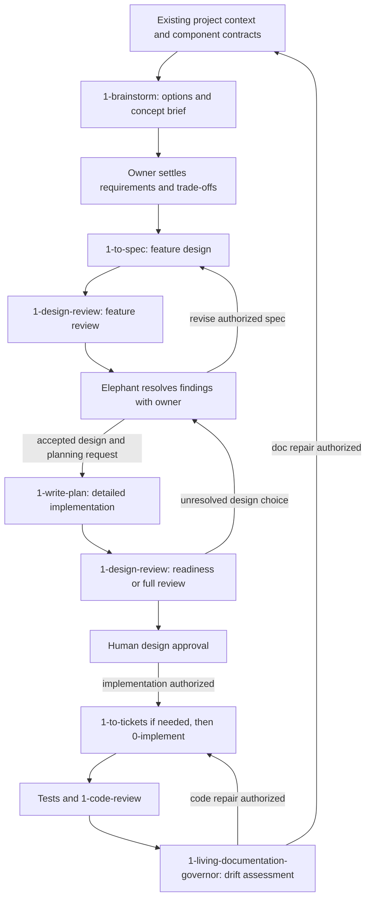

# Elephant-Goldfish: workflow, connections, and development concepts

Modified adaptation of [Google EGM](https://github.com/google/elephant-goldfish-model/tree/0dfb5bf3eebd551d1e805c3ab16cbaa9b1c2c42a),
Apache-2.0. [Source review and original snapshot](./source-review.md).

## The software-development idea

An Elephant retains project history while exploring and writing. Goldfish test the resulting
artifact without inheriting that history. If a fresh engineer cannot understand or implement the
document, the author must expose missing assumptions, revise a decision, or acknowledge a gap.
Isolation changes the evidence each reviewer receives; using the same model does not guarantee
independent judgment. The human owner still resolves architectural trade-offs and accepts risk.

The unit passed between skills is a versioned artifact with decisions and evidence, not an implied
memory of the conversation. Keep the problem, alternatives/reasons, non-goals, accepted decisions,
open questions and code links together. Prefer existing project conventions over fixed filenames.

## All seven upstream capabilities and their catalog owners

| Upstream capability | Catalog owner | What crosses the boundary |
|---|---|---|
| `egm-brainstorm` | [1-brainstorm](../../1-brainstorm/SKILL.md); sustained interview stays [0-grilling](../../0-grilling/SKILL.md) | Options memo/concept brief, six risk lenses, alternatives and chosen direction; [concept review](../../1-brainstorm/references/egm-concept-review.md) |
| `egm-draft` | [1-to-spec](../../1-to-spec/SKILL.md), then [1-write-plan](../../1-write-plan/SKILL.md) when requested | Settled brief → self-contained spec; detailed implementation plan remains its own artifact/job |
| `egm-review` | [1-design-review](../SKILL.md) | Pinned spec/plan → five ordered review stages and coverage ledger |
| `egm-review-loop` | [review protocol](./review-protocol.md) within the same design-review job | Semantic scope + reviewer/rubric mapping → fresh reviews, deduplication, bounded convergence |
| `egm-resolve` | Context-rich author/caller using [resolution rules](./review-protocol.md#findings-and-resolution) | Finding IDs → contest/escalate/propose/decline; authorized repairs → new candidate for review |
| `egm-bootstrap` | [1-living-documentation-governor](../../1-living-documentation-governor/SKILL.md), scoped docs-update mode | Observed component contracts → bottom-up parent map; [contract and drift procedure](../../1-living-documentation-governor/references/egm-contracts-and-drift.md) |
| `egm-drift-report` | [1-living-documentation-governor](../../1-living-documentation-governor/SKILL.md), read-only assessment | Current docs + code revision → evidence of mismatch; owner chooses doc or code repair |

These are mappings to one owner per job, not seven new commands. Each capability may be used alone.
Small, clear fixes can go directly to implementation; EGM is useful when design choices need scrutiny.

## Connected lifecycle

An existing document with both design and plan may go directly through all five stages. Feature
review does not assert readiness; plan review does not replace feature review. Forward arrows are
conditional handoffs: a report or spec approval alone does not start the next workflow. Peer review
and checked-in specifications remain useful; publication, commits, PRs and merges need their own
authority. No periodic maintenance is scheduled by this ingestion.

## Concepts retained and their practical use

| Concept | Use in software development |
|---|---|
| Spec-driven development | Make observable behavior and acceptance explicit before costly code changes |
| Context partitioning | Check whether a design survives without its author's unstated assumptions |
| Altitude control | Solve the right problem and reuse existing code before debating helper details |
| Comprehension paraphrase | Reveal missing causal connections that a vocabulary checklist misses |
| Multiple reviewer lenses | Separate design risk, readability, code accuracy and readiness evidence |
| Semantic targeting | Follow a section after edits instead of reviewing stale line numbers |
| Traceable resolution | Keep reviewer evidence, author disagreement and human risk acceptance distinct |
| Bounded convergence | Re-check real fixes without treating endless new opinions as progress |
| Peanuts and hay | Small component contracts roll up into an architectural map without copying every detail |
| Living specifications | Compare intended contracts with actual code and deliberately reconcile divergence |
| Human ownership | Model consensus and a completed review do not decide product policy or authorize delivery |

For example, a webhook feature's brief settles retry/idempotency policy; the spec records event and
failure contracts; fresh reviewers challenge duplicates, backoff limits and operational recovery;
the plan names changed paths and tests; later drift checks compare those promises with source.
